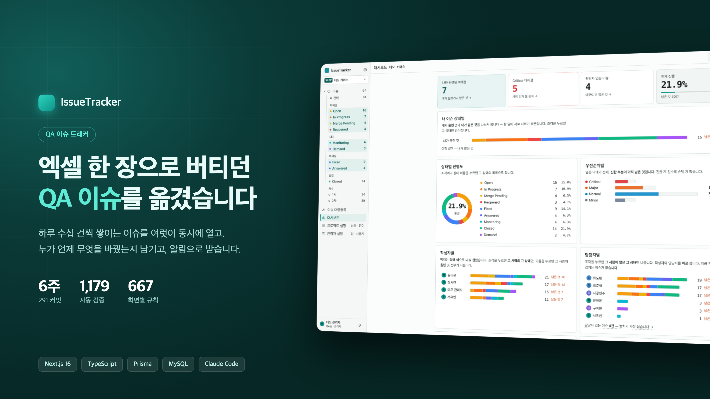
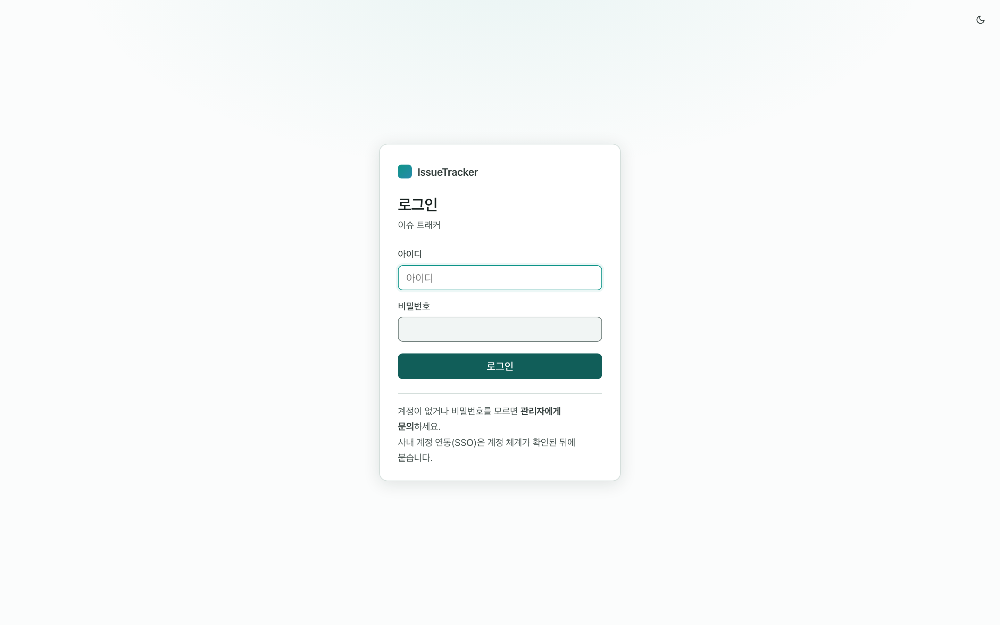
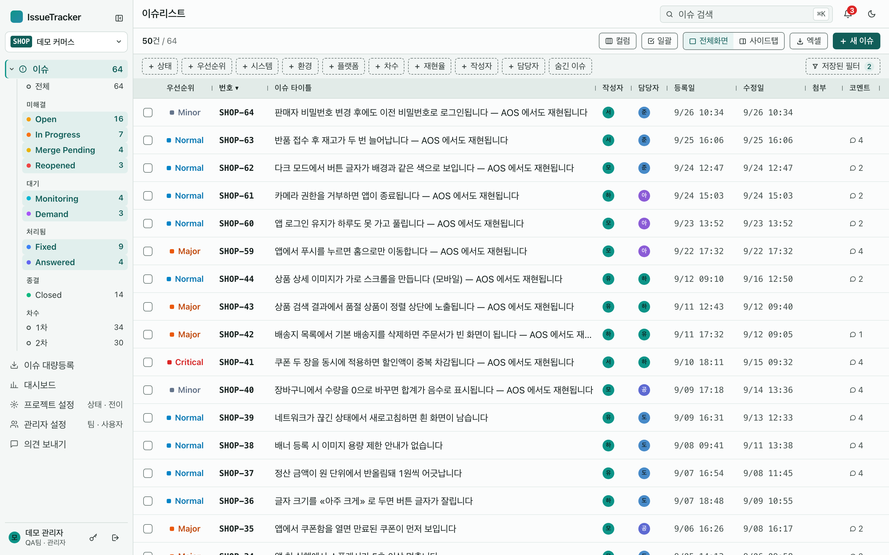
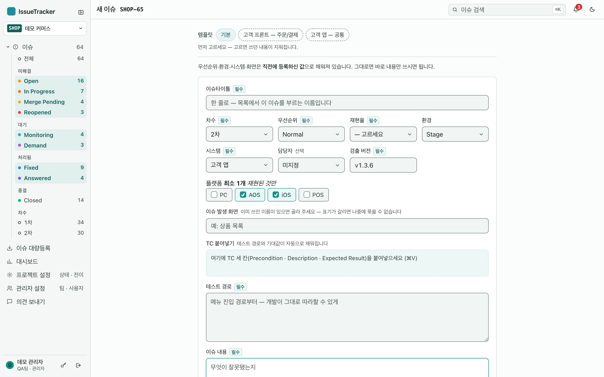
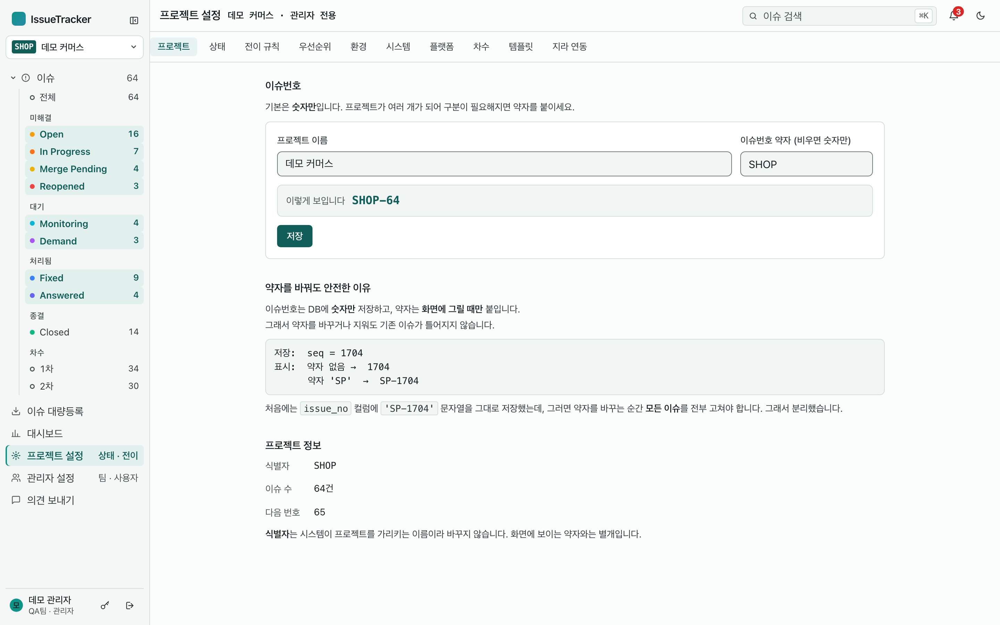
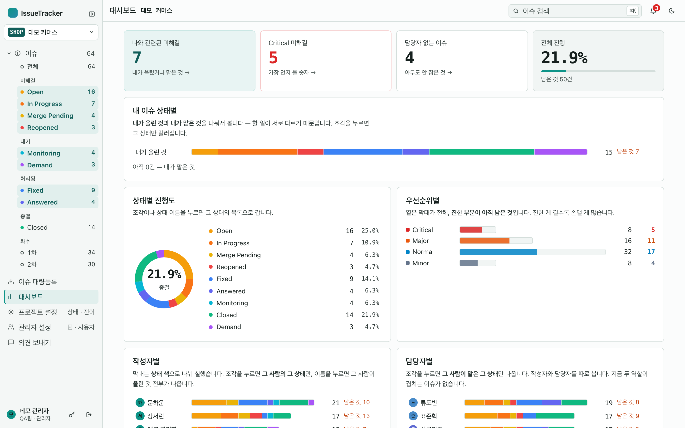
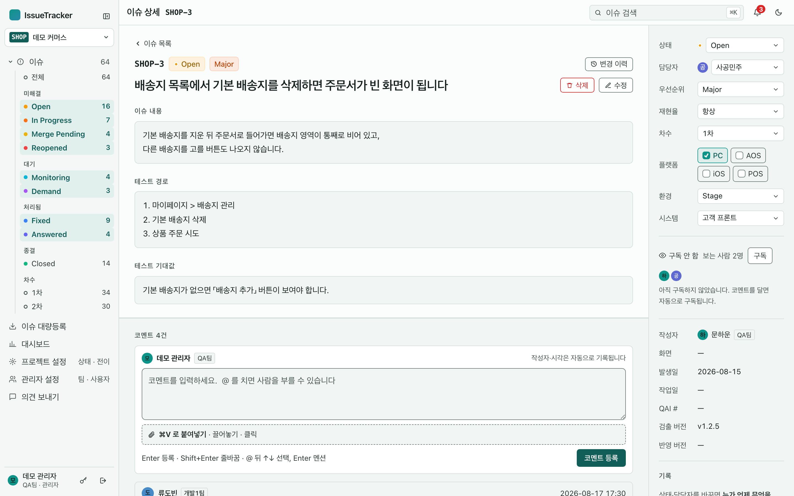
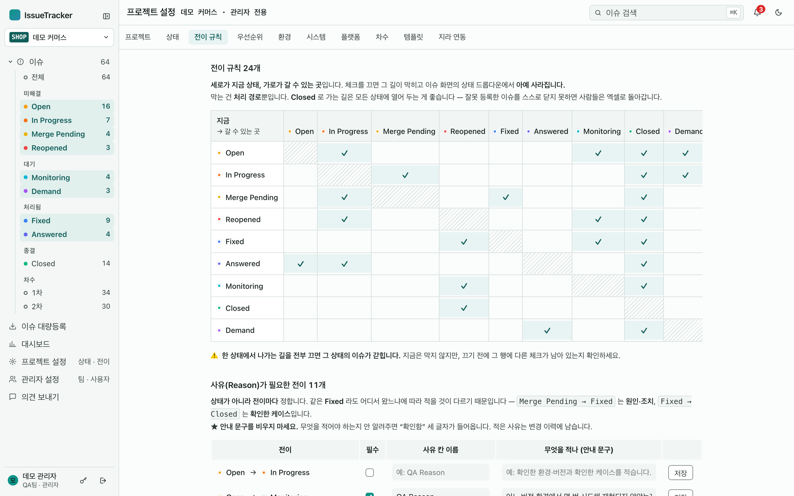

# QA Issue Tracker

> **A self-hosted issue tracker built to replace a shared Excel bug list for a QA team.**
> Next.js 16 (App Router) · React 19 · TypeScript · Prisma 7 · MySQL 8.4 (Docker).
> Starts empty — you create your own projects, teams and accounts. Optional sample data (`npm run demo`) for a quick look. — *Korean below.*



<sub>표지의 숫자(커밋·자동 검증·규칙)는 원래 개발 저장소 기준입니다. 이 공개본은 그 코드의 스냅숏입니다.</sub>

**QA 팀이 공용 엑셀 한 장으로 관리하던 이슈리스트를 대체하려고 만든 이슈 트래커**입니다.
여럿이 동시에 열 수 없고, 누가 언제 무엇을 바꿨는지 남지 않던 엑셀의 불편을 없애는 것이 목표였습니다.
기능을 늘리기보다 **엑셀에서 불편했던 것을 하나씩 없애는** 방향으로 만들었습니다.

> 이 저장소는 포트폴리오용 공개본입니다. 데이터는 전부 **지어낸 예시**이고,
> 사내 문서와 개발 이력은 들어 있지 않습니다.

---

## 한눈에 보기

> 화면의 프로젝트·사람·이슈는 전부 **예시 데이터**(`npm run demo`)입니다.

### ① 로그인



자체 계정으로 로그인합니다. 계정은 관리자가 화면에서 만들고, **임시 비밀번호**를 받아 첫 로그인 뒤 직접 바꿉니다.

### ② 이슈 목록



왼쪽 사이드바가 **프로젝트 → 상태별·차수별 건수**를 보여 주고, 누르면 그대로 걸러집니다.
필터 9가지는 **여러 개를 함께** 걸 수 있고, 조건은 **주소(URL)에 담겨** 링크를 보내면 상대도 같은 화면을 봅니다.
보이는 칸과 폭을 직접 고르고, 체크한 이슈를 **한 번에** 바꾸고, 보이는 그대로 **엑셀로** 내려받습니다.

### ③ 이슈 등록



엑셀 컬럼 순서 그대로 적습니다. **직전에 등록한 값**이 미리 채워지고, **템플릿**을 고르거나
TC 엑셀 세 칸을 **붙여넣으면** 테스트 경로·기대값이 자동으로 채워집니다. 스크린샷은 **⌘V** 로 바로 첨부됩니다.

### ④ 프로젝트 설정



**상태 · 전이 규칙 · 우선순위 · 환경 · 시스템 · 플랫폼 · 차수 · 템플릿 · 지라 연동**을 프로젝트마다 따로 정합니다.
상태와 규칙이 코드가 아니라 **데이터**라서, 새 프로젝트는 기존 프로젝트를 **복제**해 5분 안에 세팅합니다.

### 그 밖에

| 대시보드 — 모든 숫자가 목록으로 가는 입구 | 이슈 상세 — 본문 · 코멘트 · 첨부 · 변경 이력 |
|---|---|
|  |  |
| **전이 규칙** — 어디서 어디로 갈 수 있나, 사유를 받을지 | |
|  | |

---

## 빠른 시작 — 빈 상태에서 내 것으로

**아무 데이터 없이 시작합니다.** 사람·팀·프로젝트는 전부 직접 만듭니다.

준비물: **Node 24** · **Docker**(Docker Desktop 또는 [OrbStack](https://orbstack.dev)) · git

```bash
git clone https://github.com/seaheegood/qa-issue-tracker.git
cd qa-issue-tracker
cp .env.example .env
docker compose up -d                  # MySQL 8.4 (호스트 포트 3307)
npm ci
npx prisma migrate deploy             # 빈 DB 에 표 만들기
npm run setup -- <키> "<이름>"          # 첫 프로젝트. 키는 이슈번호 앞에 붙는 약자 (예: WEB → WEB-1)
npm run user -- create <아이디> "<이름>" '<비밀번호>' --admin    # 첫 관리자
npm run dev                           # http://localhost:3000
```

첫 프로젝트에는 **상태 9종 · 전이 규칙 · 우선순위 · 환경 · 플랫폼 · 차수** 같은 설정의 기본값만 들어갑니다.
사람 · 팀 · 시스템 · 이슈는 **비어 있습니다.**

로그인한 뒤 이 순서로:
1. **프로젝트 설정 › 시스템** — 이슈 등록의 필수값이라 제일 먼저
2. **관리자 설정 › 팀** — 팀과 직군(QA/개발/기획)
3. **관리자 설정 › 사용자** — 동료 추가 (임시 비밀번호가 한 번 표시됩니다)

### 예시 데이터로 둘러보기 (선택)

화면을 먼저 보고 싶으면, **빈 DB 에서** 위의 `migrate deploy` · `setup` · `user` 대신:

```bash
npm run demo        # 가공의 프로젝트 2개 · 이슈 78건 · 가공의 사람들
npm run dev         # demo / demo1234 (관리자)
```

> 예시 데이터는 **전부 지어낸 것**입니다 (아래 스크린샷도). `npm run demo` 는 DB 가 비어 있을 때만 돌고,
> 이미 쓰던 데이터가 있으면 멈춥니다 (`npm run demo -- --reset` 으로만 지웁니다).

사내망의 PC 한 대에 띄워 여럿이 쓰려면 `npm run serve`(빌드 후 `0.0.0.0` 으로 공개)나
`bash scripts/install.sh`(pm2 로 상시 구동)를 쓰면 됩니다.

---

## 무엇이 되나

| 엑셀에서 이랬던 것 | 여기서는 |
|---|---|
| 코멘트에 `7/20 10:05 QA)` 를 손으로 타이핑 | 작성자·팀·시각이 **자동으로** 남는다. 대댓글 · `@멘션` · 알림 |
| 누가 셀을 덮어써도 아무도 모름 | 모든 변경이 **변경 이력**에 남는다 — 긴 글은 전·후 전문까지 |
| 상태를 아무 값으로나 바꿈 | 상태 9종 · **전이 규칙** · 전이마다 필요한 **사유(Reason)** |
| 필터를 걸면 남이 보는 화면도 바뀜 | 필터가 **주소(URL)** 에 담긴다. 링크를 보내면 같은 화면 |
| 스크린샷을 파일로 저장해 붙임 | **⌘V** 로 바로 첨부 |
| 테스트케이스를 옮겨 적음 | TC 엑셀 세 칸을 **붙여넣으면** 테스트 경로·기대값이 채워진다 |

그 밖에 — 대시보드(모든 숫자가 그 조건의 목록으로 가는 링크) · 저장된 필터 · 일괄 편집 · 이슈 템플릿 ·
엑셀 내보내기 · **고객사 엑셀 대량등록**(양식이 달라도 열을 이어서 등록) · 여러 프로젝트 ·
사이드 패널로 상세 보기 · 지라로 보내기 · 다크 모드 · 좁은 화면 · 앱 안 의견 보내기.

---

## 설계에서 중요하게 본 것

- **상태는 코드가 아니라 데이터다.** 상태·전이 규칙·우선순위·환경·플랫폼을 전부 프로젝트별 표로 둔다.
  enum 으로 박으면 두 번째 프로젝트를 붙이는 순간 코드를 고쳐야 한다.
- **화면의 숫자 = 링크를 눌렀을 때 나오는 건수.** 목록·엑셀 내보내기·저장된 필터가
  같은 조건 함수(`src/lib/issue-filter.ts` 의 `buildWhere`)를 쓴다. 따로 만들면 *"화면엔 21건인데 파일엔 1,704건"* 이 된다.
- **지우지 않는다.** 이슈는 숨기고, 설정은 끄고, 사람은 비활성으로 돌린다. 기록이 남아야 한다.
- **입력이 엑셀보다 느리면 사람들은 엑셀로 돌아간다.** 필수 10칸이지만 직전 값·템플릿·붙여넣기·`⌘Enter` 로 줄였다.
- **세션은 JWT 가 아니라 DB 에.** 퇴사자 차단·로그아웃이 즉시 반영돼야 하는 사내 도구라서.
  쿠키 토큰은 해시로만 저장하고, 비밀번호는 bcrypt.
- **엑셀을 라이브러리 없이 읽고 쓴다** (`src/lib/xlsx-read.ts` · `xlsx.ts`) — 실제 파일과 셀 단위로 대조했다.

## 기술 스택

| | | 왜 |
|---|---|---|
| 프레임워크 | **Next.js 16** (App Router · Server Actions) · React 19 | 화면과 서버를 한 저장소에서. JS 없이도 폼이 동작한다 |
| 언어 | TypeScript | |
| DB | **MySQL 8.4** (Docker) · **Prisma 7** | 한글 전문검색(ngram) · 마이그레이션 이력 |
| 인증 | 자체 계정 + DB 세션 · bcrypt | 사내 SSO 가 정해지면 검증 한 곳만 바꾸면 된다 |
| 스타일 | 순수 CSS (디자인 토큰 · 라이트/다크 · 명암비 AAA) | |
| 운영 | pm2 · 백업/복구 스크립트(복구 검증 포함) | PC 한 대로 시작할 수 있게 |

## 폴더

```
src/app/(app)/p/[key]/…   프로젝트 안 화면 (이슈 · 대시보드 · 설정 · 대량등록)
src/app/(app)/admin/…     회사 전체 설정 (팀 · 사용자 · 프로젝트 · 의견)
src/lib/                  한 곳에서만 하는 일 — 필터 조건 · 권한 · 알림 · 엑셀 · 저장소
prisma/                   스키마 · 마이그레이션 · 기본 설정(masters.ts) · 예시 데이터(seed-demo.ts)
scripts/                  계정 · 백업/복구 · 설치 · 배포 · 예시 데이터
```

> 코드 주석의 `D-09` · `A-105` 같은 번호는 원래 저장소의 **기능 명세서 규칙 번호**입니다.
> 명세서는 이 공개본에 들어 있지 않지만, 주석이 *왜 그렇게 했는지*를 대부분 설명합니다.

## 명령

| 명령 | 하는 일 |
|---|---|
| `npm run setup -- <키> <이름>` | 빈 DB 에 첫 프로젝트 |
| `npm run demo` | (선택) 예시 데이터 — 빈 DB 에서만 |
| `npm run user -- list \| create \| password \| admin` | 계정 |
| `npm run dev` / `npm run serve` | 개발 서버 / 빌드해서 사내망에 공개 |
| `npm run backup` / `npm run restore` | 백업 (임시 DB 에 부어 건수까지 대조) · 복구 |

## 라이선스

MIT
